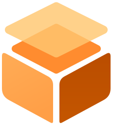
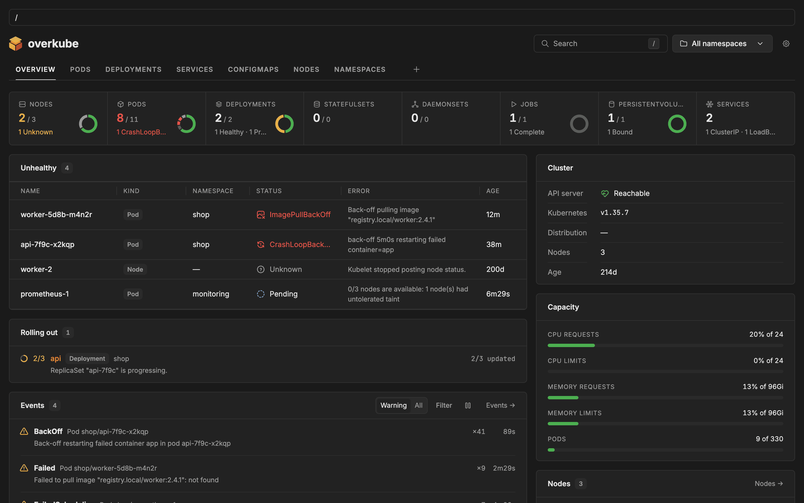
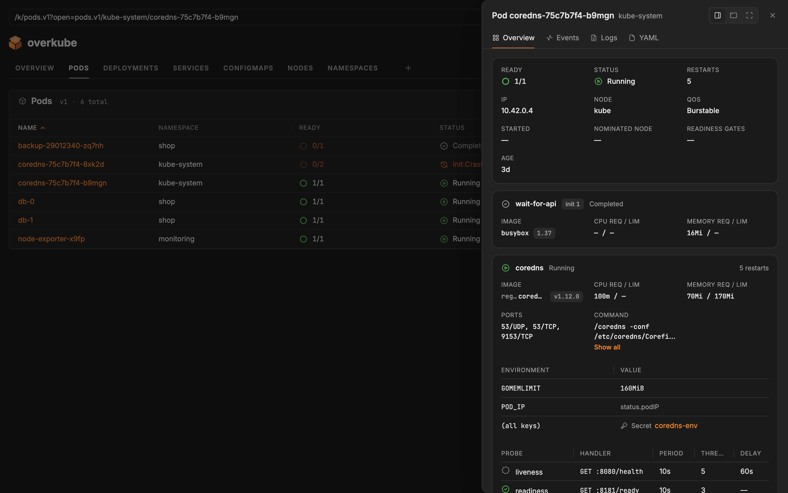
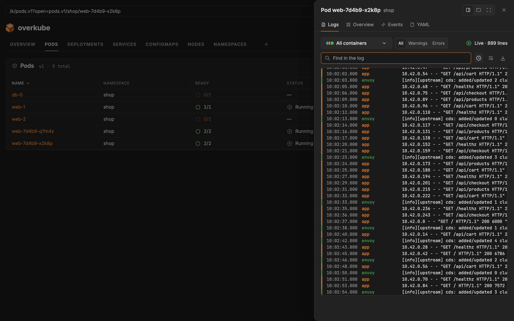

<p align="center"></p>

# overkube

> **Experimental — 0.x.** It shows a cluster as the one signed in may see it — no actions on it yet; the addon API changes before 1.0.

A dashboard for Kubernetes clusters, built on [overweave](https://github.com/overweave/overweave): what it shows — kinds, tables, columns, pages, actions — is contributed by addons and layered over one another; the user's own changes are one more layer.



| A pod, its containers | Its logs, live |
|---|---|
|  |  |

## Install

Three ways; each has its guide.

- **In a cluster** — the Helm chart, from a release or from this repository ([docs/cluster.md](docs/cluster.md)):

  ```bash
  helm install overkube oci://ghcr.io/overweave/charts/overkube --version <version> -n overkube --create-namespace
  kubectl -n overkube port-forward svc/overkube 8443:8443   # then https://localhost:8443
  ```

  Or plain manifests, a release's `overkube.yaml`: `kubectl create namespace overkube && kubectl apply -n overkube -f https://github.com/overweave/overkube/releases/download/v<version>/overkube.yaml`.

- **On this machine, against a cluster of a kubeconfig** — the image ([docs/local.md](docs/local.md)):

  ```bash
  docker run --rm -p 127.0.0.1:8443:8443 -v "$HOME/.kube/config:/kubeconfig:ro" -e KUBECONFIG=/kubeconfig \
    -e OVERKUBE_LOCAL_NETWORK=true -e OVERKUBE_HOSTS=localhost,127.0.0.1 ghcr.io/overweave/overkube:<version>
  ```

  Or from the sources, with Node 24: `npm ci`, `npm run build -w @overkube/web`, `OVERKUBE_UI="$PWD/apps/web/dist" npm start -w @overkube/server`.

- **To work on it** — the dev stand, only Docker needed ([docs/development.md](docs/development.md)):

  ```bash
  make dev   # a cluster, the server, the page at http://localhost:5173
  ```

The image is `ghcr.io/overweave/overkube` (linux/amd64, linux/arm64), the chart `oci://ghcr.io/overweave/charts/overkube`, both tagged with the release's version; every release is at [github.com/overweave/overkube/releases](https://github.com/overweave/overkube/releases).

## The server

`apps/server` is overkube's own server: the gateway to the cluster (`@overkube/gateway`, under `/kube`), signing in at `/auth`, the page at `/`, `/healthz` and `/readyz`. It is configured by its environment (the one reference: the header of [apps/server/src/config.ts](apps/server/src/config.ts)):

| Variable | Default | |
|---|---|---|
| `OVERKUBE_HOST` | `127.0.0.1` | Where it listens (`0.0.0.0`: any address) |
| `OVERKUBE_PORT` | `8080` | Its port (the image: `8443`) |
| `OVERKUBE_READ_ONLY` | `false` | Nothing that changes the cluster (`true` or `false`: anything else stops it from starting). Reading still shows everything one may read, Secrets too |
| `OVERKUBE_UI` | — | The built page's folder (none: no page, the gateway alone) |
| `OVERKUBE_HOSTS` | this machine's names, when it listens on it; else required | The names it is reached by (`dash.example.org,localhost`); a request by any other is refused (421) — a DNS rebinding cannot make another site's name reach it |
| `OVERKUBE_LOCAL_NETWORK` | `false` | The network it listens on reaches only this machine (a container published on `127.0.0.1`): as if it listened there |
| `OVERKUBE_AUTH` | `loopback` | Who uses the cluster — below |
| `OVERKUBE_SESSION_HOURS` | `8` | How long one stays signed in at most (up to 720; a token's own end, sooner) |
| `OVERKUBE_TLS_CERT`, `OVERKUBE_TLS_KEY` | — | Its certificate and key (PEM, read again as they change): HTTPS, plain HTTP on the same port sent there (`/healthz`, `/readyz` aside) |
| `OVERKUBE_TLS` | — | `off`: a proxy in front ends TLS (its `X-Forwarded-Proto` taken) |
| `KUBECONFIG` | — | The cluster: `KUBECONFIG`'s first file, else the pod's ServiceAccount, else `~/.kube/config` — the file must exist, or it does not start |

Who uses the cluster (`OVERKUBE_AUTH`):

- **`loopback`** — no one signs in: whoever reaches it uses the cluster as its kubeconfig (or ServiceAccount) may. Only where only this machine reaches it (`127.0.0.1`, or `OVERKUBE_LOCAL_NETWORK`): elsewhere it does not start.
- **`token`** — one signs in with a token the cluster takes, `kubectl -n <namespace> create token <service-account> --duration=8h`, and uses the cluster as it: the token goes to the API server in place of the server's credentials, which then need no rights at all. Signed in until the token ends.
- **`oidc`** — one signs in with an OpenID Connect provider (the authorization code flow, PKCE) until the ID token ends, and is impersonated: its user and groups claims, prefixed — the server's credentials need only `impersonate` on them. An email names one only once the provider says it is verified (`email_verified`). `OVERKUBE_OIDC_ISSUER`, `OVERKUBE_OIDC_CLIENT_ID` (its redirect URI: `https://<a name of it>/auth/oidc/callback`), `OVERKUBE_OIDC_CLIENT_SECRET` (none: a public client), `OVERKUBE_OIDC_SCOPES` (`openid profile email`), `OVERKUBE_OIDC_USER_CLAIM` (`email`), `OVERKUBE_OIDC_GROUPS_CLAIM` (`groups`), `OVERKUBE_OIDC_PREFIX` (`oidc:`; never `system:`). A provider of a private CA: `NODE_EXTRA_CA_CERTS`.

Signing in is only over HTTPS — its own certificate, or a proxy's in front (`OVERKUBE_TLS=off`: it sets `X-Forwarded-Proto` and `X-Forwarded-For` itself — of a list, the last is taken: the nearest proxy's) — or by this machine's own names (`http://localhost`; Safari keeps no session there: use HTTPS). So many sign-ins a minute from one client. A session is kept in the server's memory — a restart signs everyone out, a token is never written anywhere, and a server in a cluster runs as one replica — its id in a cookie only the page has (`HttpOnly`, `Secure`, `SameSite=Strict`). Whatever one signed in may not do, the page does not show.

Its kubeconfig signs in with a token (or a token file) or a client certificate. One that signs in otherwise — `exec` plugins (EKS, GKE, AKS, OIDC), an `auth-provider`, a username and password — or goes through a `proxy-url` is refused with the reason (the server's log; `/kube/status` says it, `/readyz` only that the cluster is not ready): give it a token, or run it in the cluster. A kubeconfig with several contexts names the one to use (`current-context`).

A workload's port is reached as data — for addons that ask what runs in the cluster — at `/kube/proxy/services/<namespace>/<[scheme:]name:port>/<path>` (or `pods/…`): through the API server's proxy, as the one signed in, so RBAC decides (`services/proxy`, `pods/proxy`); GET and HEAD alone, 16 MiB at most, never shown as a page. No page of another site reaches the cluster through its visitor's browser: a cross-site request is refused, and anything but a read carries the `x-overkube` header — a script of its own (curl) sends it too: `-H 'x-overkube: 1'`. The whole protocol: [packages/gateway](packages/gateway/README.md).

## What is in the repository

One npm workspace (`packages/*`, `apps/*`, `addons/*`); every package is ESM, TypeScript, at version 0.1.2 together, and private for now — none is on a registry; what ships is the image and the chart. Each has a README.

| | What |
|---|---|
| [apps/server](apps/server/README.md) | The server above: `@overkube/server` |
| [apps/web](apps/web/README.md) | The page: `@overkube/web`, built to `apps/web/dist` |
| [addons/core](addons/core/README.md) | The core addon: everything the page shows that no other addon does |
| [addons/metrics](addons/metrics/README.md) | The metrics addon: what pods and nodes use, now (metrics-server) and over time (VictoriaMetrics, Prometheus) |
| [packages/sdk](packages/sdk/README.md) | `@overkube/sdk` — what addons are written with |
| [packages/gateway](packages/gateway/README.md) | `@overkube/gateway` — the way to the cluster, for any Node host |
| [packages/connector](packages/connector/README.md) | `@overkube/connector` — the page's side of the gateway: feeds, the stream, logs |
| [packages/source](packages/source/README.md) | `@overkube/source` — queries answered from what the page watches |
| [packages/query](packages/query/README.md) | `@overkube/query` — fields, queries and results, as data |
| [packages/cel](packages/cel/README.md) | `@overkube/cel` — CEL as the fields have it |
| [packages/kube-fields](packages/kube-fields/README.md) | `@overkube/kube-fields` — the built-in kinds' fields, a CRD's columns |
| [packages/kube-types](packages/kube-types/README.md) | `@overkube/kube-types` — the kinds' TypeScript types |
| [packages/typegen](packages/typegen/README.md) | `@overkube/typegen` — those types generated from a cluster |
| [packages/shell](packages/shell/README.md) | `@overkube/shell` — the frame the page is drawn in |
| [packages/runtime](packages/runtime/README.md) | `@overkube/runtime` — one way to run an addon |
| [packages/uikit](packages/uikit/README.md) | `@overkube/uikit` — the UI kit |
| [packages/testkit](packages/testkit/README.md) | `@overkube/testkit` — testing addons without the page or a cluster |
| [packages/storybook](packages/storybook/README.md) | `@overkube/storybook` — addons in Storybook |
| [packages/fake-kube](packages/fake-kube/README.md) | A fake API server for the tests (private) |

overweave's packages (`@overweave/*`) come from npmjs.org, as any other dependency. To work on overweave and overkube at once: `make link-overweave` ([docs/development.md](docs/development.md#overweave-beside-it)).

## Working on it

Only Docker is needed: `make dev` is the dev stand, `make check` everything CI checks (lint and format, types, tests), `make storybook` the core's stories. All of it: [docs/development.md](docs/development.md); how to contribute: [CONTRIBUTING.md](CONTRIBUTING.md).

## License

MIT — [LICENSE](LICENSE). Two packages carry others' work, said in their NOTICE: `@overkube/kube-types` the Kubernetes API's descriptions (Apache License 2.0, [NOTICE](packages/kube-types/NOTICE)), `@overkube/uikit` Tabler's icons (MIT, [NOTICE](packages/uikit/NOTICE)).

Kubernetes is a registered trademark of The Linux Foundation. overkube is not affiliated with or endorsed by it.
